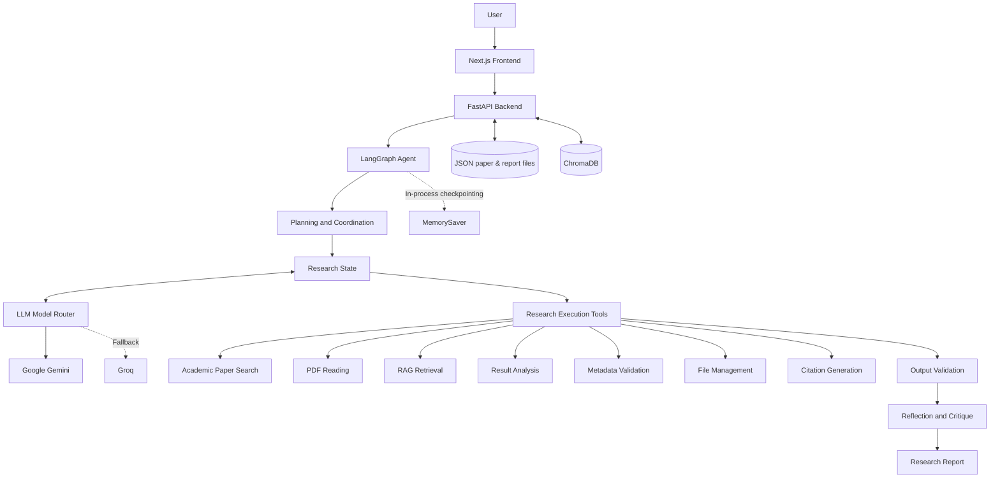

# AIRA — System Architecture

## 1. Overview

AIRA (Amharic Intelligent Research Assistant) is an agentic AI system designed to support academic research workflows.

The system combines:

- A Next.js frontend for user interaction.
- A FastAPI backend for application services and API access.
- LangGraph for stateful agent orchestration.
- Gemini and Groq for language-model reasoning and fallback.
- Seven research execution tools.
- ChromaDB for vector-based research retrieval.
- Local JSON files for extracted papers and generated reports (SQLite is configured but not yet used).

The architecture separates user interaction, agent orchestration, research tools, and data storage.

## 2. High-Level Architecture

## 3. Main Components

### 3.1 Frontend

The frontend is built with Next.js, React, TypeScript, and Tailwind CSS.

Its responsibilities include:

- Accepting research queries.
- Displaying agent execution progress.
- Collecting clarification from users.
- Displaying research reports and retrieved information.
- Providing access to indexed papers and saved reports.

The frontend communicates with the backend through HTTP API requests and polls for execution progress.

### 3.2 Backend

FastAPI provides the application's backend interface.

Its responsibilities include:

- Exposing REST API endpoints.
- Managing research sessions.
- Handling paper search and upload requests.
- Coordinating access to application services.
- Serving frontend requests.
- Providing API documentation.

### 3.3 Agent Orchestration

LangGraph manages the research workflow through a stateful graph.

The graph includes nodes for:

- Receiving and interpreting requests.
- Checking whether additional information is required.
- Creating and updating research plans.
- Selecting and executing tools.
- Validating tool outputs.
- Retrying failed operations.
- Storing evidence.
- Reflecting on results.
- Critiquing findings.
- Generating final reports.

Conditional routing allows the agent to adapt its execution path based on the current state and tool results.

### 3.4 LLM Model Router

The model router manages language-model access.

- Gemini is the primary provider.
- Groq is the fallback provider.
- Provider errors are classified and handled using bounded retry and fallback policies.
- When both providers are unavailable, the system can enter degraded mode.

In degraded mode, supported deterministic operations remain available even when LLM reasoning is unavailable.

### 3.5 Research Execution Tools

| Tool                  | Responsibility                              |
| --------------------- | ------------------------------------------- |
| Academic Paper Search | Discover papers through academic registries |
| PDF Reading           | Extract text and sections from PDFs         |
| RAG Retrieval         | Retrieve relevant research passages         |
| Result Analysis       | Compare experimental metrics                |
| Metadata Validation   | Cross-check academic metadata               |
| File Management       | Manage research files                       |
| Citation Generation   | Produce formatted academic citations        |

### 3.6 Meta-tools

Meta-tools support the agent's decision-making and coordination.

They provide:

- Research planning.
- Plan revision.
- User clarification.
- Tool coordination.
- Finding critique.
- Research completion control.

## 4. Data and Storage Architecture

### Local file storage

Extracted papers are stored as JSON in `PROCESSED_DIRECTORY`. Generated reports are
saved as JSON and Markdown in `REPORTS_DIRECTORY` by the File Management tool, so the
report archive survives restarts. Research sessions are held in LangGraph's in-memory
checkpointer and do **not** survive a restart. `DATABASE_URL` (SQLite) is configured,
but no component reads or writes it yet.

### ChromaDB

ChromaDB stores vector representations of indexed research passages and supports semantic retrieval.

### File Storage

The application maintains directories for:

- Original research papers.
- Processed research documents.
- Generated reports.
- Vector database persistence.

### LangGraph Checkpointing

The current graph uses LangGraph's in-process `MemorySaver` checkpoint mechanism.

Graph checkpoints are not durable across application process restarts. Durable checkpoint persistence is a future improvement.

## 5. Research Workflow

A typical research request follows this adaptive process:

1. The user submits a research question.
2. The backend creates a research session.
3. LangGraph initializes the research state.
4. The agent determines whether clarification is necessary.
5. A research plan is created.
6. Appropriate tools are selected and executed.
7. Tool outputs are validated.
8. Failed operations may be retried with corrected inputs, subject to configured limits.
9. Relevant evidence is stored.
10. The agent reflects on and critiques the findings.
11. A research report is generated when the task is complete.

The workflow can branch, retry, or request additional information instead of following a strictly linear pipeline.

## 6. Reliability and Error Handling

AIRA uses several mechanisms to improve reliability:

- Bounded retries for supported transient failures.
- Fallback between LLM providers.
- Validation of tool outputs.
- Academic metadata cross-checking.
- PDF extraction error handling.
- Degraded mode for deterministic operations.
- Execution limits to prevent unbounded agent loops.

## 7. Security Considerations

The architecture incorporates:

- Environment-based API credential management.
- Git-ignored local environment files.
- External URL validation for document downloads.
- PDF upload size limits and request timeouts.
- Input and output validation.
- Treatment of retrieved document content as untrusted input.

## 8. Current Limitations

- OCR transcription for scanned PDFs is not implemented.
- Production semantic retrieval quality has not yet been validated with a real embedding benchmark.
- Graph checkpoints are currently in-process rather than durable.
- Complex PDF layouts and tables can produce imperfect extraction.
- Automated evidence validation is heuristic and does not replace expert review.
- Current evaluation includes component-level tests and does not establish broad real-world end-to-end performance.

## 9. Future Architecture Improvements

Potential improvements include:

- OCR integration.
- Durable LangGraph checkpoint storage.
- Expanded bilingual Amharic and English retrieval evaluation.
- Stronger claim-level evidence verification.
- More comprehensive end-to-end agent testing.
- Improved extraction of complex tables and document layouts.

---

**AIRA — Amharic Intelligent Research Assistant**
