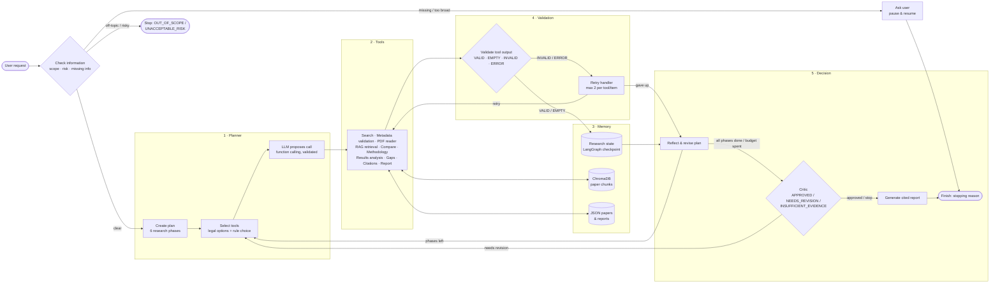
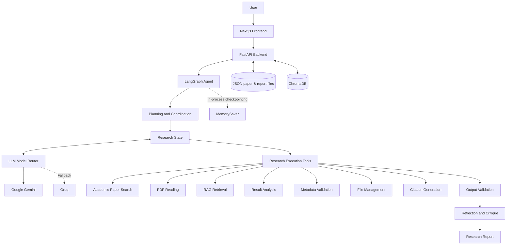

# AIRA — System Architecture

## 1. Overview

AIRA (Amharic Intelligent Research Assistant) is an agentic AI system designed to support academic research workflows.

The system combines:

- A Next.js frontend for user interaction.
- A FastAPI backend for application services and API access.
- LangGraph for stateful agent orchestration.
- Gemini and Groq for language-model reasoning and fallback.
- Ten research execution tools, chosen by LLM function calling and validated by code.
- ChromaDB for vector-based research retrieval.
- Local JSON files for extracted papers and generated reports (SQLite is configured but not yet used).

The architecture separates user interaction, agent orchestration, research tools, and data storage.

## 2. Agent Loop: planner → tools → memory → validation → decision

This is the agent's control loop as implemented in `agents/graph.py` and `agents/routing.py`.
Each box is a LangGraph node (or a store it reads and writes); each labelled arrow is a
conditional edge.

| Stage | Nodes / components | Role |
| --- | --- | --- |
| 1 · Planner | `create_plan`, `select_tools`, `propose_tool_call` | Phase plan; legal next calls; LLM proposal validated by code |
| 2 · Tools | `execute_tools` + 10 execution tools | Search, validation, PDF, RAG, analysis, citations, report |
| 3 · Memory | `ResearchState` (LangGraph checkpoint), ChromaDB, JSON files | Run state and evidence; paper chunks; papers and reports |
| 4 · Validation | `validate_tool_outputs`, `retry_handler`, `store_evidence` | VALID/EMPTY/INVALID/ERROR; at most 2 retries; only valid output becomes evidence |
| 5 · Decision | `reflect_and_revise`, `critique_findings`, `generate_report`, `finish_task` | Loop, revise the plan, or stop with an explicit stopping reason |

## 2b. High-Level Architecture (components)

## 3. Main Components

### 3.1 Frontend

The frontend is built with Next.js, React, TypeScript, and Tailwind CSS.

Its responsibilities include:

- Accepting research queries.
- Displaying agent execution progress.
- Collecting clarification from users.
- Displaying research reports and retrieved information.
- Providing access to indexed papers and saved reports.

The frontend communicates with the backend through HTTP API requests and polls for execution progress.

### 3.2 Backend

FastAPI provides the application's backend interface.

Its responsibilities include:

- Exposing REST API endpoints.
- Managing research sessions.
- Handling paper search and upload requests.
- Coordinating access to application services.
- Serving frontend requests.
- Providing API documentation.

### 3.3 Agent Orchestration

LangGraph manages the research workflow through a stateful graph.

The graph includes nodes for:

- Receiving and interpreting requests.
- Checking whether additional information is required.
- Creating and updating research plans.
- Selecting and executing tools.
- Validating tool outputs.
- Retrying failed operations.
- Storing evidence.
- Reflecting on results.
- Critiquing findings.
- Generating final reports.

Conditional routing allows the agent to adapt its execution path based on the current state and tool results.

#### Tool selection: the LLM proposes, the code disposes

Tool selection is hybrid (`agents/tool_calling.py`, node `propose_tool_call`). It follows the function-calling pattern of the course brief (slides 10-14): "the model decides what to ask for; the application decides what to trust and execute".

1. **Rules define what is legal.** `select_tools` computes the rule-based choice and the list of *legal options* for the current step: every remaining PDF candidate during extraction, every remaining analysis action during `compare_and_analyze`, and the single action elsewhere. The phase order, the stopping rules and the retry policy stay in code.
2. **The LLM proposes.** When there is a real choice (two or more options, or a tool with free arguments: search, retrieval, gap analysis), `propose_tool_call` sends Gemini, or Groq as the fallback, a compact state summary and the function declarations (`TOOL_SPECS`) of the legal tools only. It uses native function calling: Gemini `mode=ANY` with automatic function calling disabled, Groq `tool_choice="required"`. Paper titles and other API-sourced text are sent as `<untrusted_data>`.
3. **Code validates.** The proposal is accepted only if the tool is legal in the current phase, the arguments pass the tool's Pydantic model (unknown fields forbidden), no free-text argument contains a URL or path, every paper id belongs to the session, and an LLM-written search query passes the same scope/risk check as user requests. Numeric limits (`max_results`, `top_k`, the user's year range) are clamped. The LLM never supplies URLs, file paths, metadata payloads or citation requests: code fills those in from the session state. For whole-phase analyses (comparison, methodology, results, gaps, report) the paper list is always every extracted paper, because a subset would silently drop evidence; only retrieval may be narrowed.
4. **Rules fall back.** An invalid proposal, a degraded or failing router, or a call slower than `TOOL_SELECTION_TIMEOUT_SECONDS` falls back to the rule choice. If an LLM-written search finds nothing, the retry uses the rule-built query before any reformulation.

Every decision is an observable log entry (`ACCEPTED`, `REJECTED` with the reason, `FALLBACK`, `SINGLE_OPTION`) and appears in the live event log. The counts are kept in `tool_selection_stats`, returned by the API and summarised in the report's limitations section.

**Why hybrid:** keyword routing cannot rank papers by relevance or phrase a good query, which is where an LLM helps. But the tool sequence is also a safety boundary: a hallucinated or injected tool call must not skip phases, read arbitrary URLs or fabricate citations. Keeping the rules as validator and fallback means the agent behaves at least as well as the deterministic version when the LLM is wrong or unavailable. `TOOL_SELECTION_MODE=rules` disables proposals; the test suite uses it so that it stays deterministic and offline, and the LLM-mode tests opt in explicitly.

### 3.4 LLM Model Router

The model router manages language-model access.

- Gemini is the primary provider.
- Groq is the fallback provider.
- Provider errors are classified and handled using bounded retry and fallback policies.
- When both providers are unavailable, the system can enter degraded mode.
- `ModelRouter.generate_tool_call` provides native function calling (Gemini function declarations, Groq tools). A response without a tool call, or with malformed arguments, counts as an invalid response. Tool proposals are single-shot with a time budget: one attempt per provider, the remaining budget as the HTTP timeout, and no fallback once the budget is spent.
- Rate limits: a 429 or 503 is not retried against the same provider. The provider is paused for its own "retry in N s" hint (capped at 30 s) and requests go to the other provider; when every provider is paused the call fails fast instead of entering degraded mode.
- Every request is counted per session (`api_usage` in the API response, API Usage panel in the UI).

In degraded mode, supported deterministic operations remain available even when LLM reasoning is unavailable.

### 3.5 Research Execution Tools

| Tool                  | Responsibility                              |
| --------------------- | ------------------------------------------- |
| Academic Paper Search | Discover papers through academic registries |
| PDF Reading           | Extract text and sections from PDFs         |
| RAG Retrieval         | Retrieve relevant research passages         |
| Result Analysis       | Compare experimental metrics                |
| Metadata Validation   | Cross-check academic metadata               |
| File Management       | Manage research files                       |
| Citation Generation   | Produce formatted academic citations        |

### 3.6 Meta-tools

Meta-tools act on the agent's own process. They live in `meta_tools/` as pure functions with no LangGraph dependency, so they can be unit-tested directly. Graph nodes call them and then log the decision and update state.

| Meta-tool                      | Node(s)                                |
| ------------------------------ | -------------------------------------- |
| `planner.build_research_plan`  | `create_plan`                          |
| `plan_updater.*`               | `store_evidence`, `reflect_and_revise` |
| `ask_user.assess_request`      | `check_information`                    |
| `critic.critique_research`     | `critique_findings`                    |
| `finish.determine_stopping_reason` | `finish_task`                      |

Tool selection is handled by the `select_tools` node (rules and legal options) and the `propose_tool_call` node (LLM proposal and validation, see 3.3). Tool-output checks live in `validation/tool_validation.py` and evidence rules in `validation/evidence_validation.py`. The conditional edges (branches, loops, retries, step budget) are in `agents/routing.py`; `agents/graph.py` wires nodes and edges together.

## 4. Data and Storage Architecture

### Local file storage

Extracted papers are stored as JSON in `PROCESSED_DIRECTORY`. Generated reports are
saved as JSON and Markdown in `REPORTS_DIRECTORY` by the File Management tool, so the
report archive survives restarts. Research sessions are held in LangGraph's in-memory
checkpointer and do **not** survive a restart. `DATABASE_URL` (SQLite) is configured,
but no component reads or writes it yet.

### ChromaDB

ChromaDB stores vector representations of indexed research passages and supports semantic retrieval.

### File Storage

The application maintains directories for:

- Original research papers.
- Processed research documents.
- Generated reports.
- Vector database persistence.

### LangGraph Checkpointing

The current graph uses LangGraph's in-process `MemorySaver` checkpoint mechanism.

Graph checkpoints are not durable across application process restarts. Durable checkpoint persistence is a future improvement.

## 5. Research Workflow

A typical research request follows this adaptive process:

1. The user submits a research question.
2. The backend creates a research session.
3. LangGraph initializes the research state.
4. The agent determines whether clarification is necessary.
5. A research plan is created.
6. The rules list the legal next actions; the LLM proposes one through function calling; code validates it (or falls back to the rule choice) and executes it.
7. Tool outputs are validated.
8. Failed operations may be retried with corrected inputs, subject to configured limits.
9. Relevant evidence is stored.
10. The agent reflects on and critiques the findings.
11. A research report is generated when the task is complete.

The workflow can branch, retry, or request additional information instead of following a strictly linear pipeline.

## 6. Reliability and Error Handling

AIRA uses several mechanisms to improve reliability:

- Bounded retries for supported transient failures (max 2 per tool and item).
- Fallback between LLM providers, with per-provider cooldowns after rate limits.
- Rule-based fallback for every LLM tool proposal, and a circuit breaker that pauses proposals after 2 consecutive failures.
- Semantic Scholar request pacing (1.1 s) and skipping it when Crossref and OpenAlex already agree.
- Validation of tool outputs.
- Academic metadata cross-checking.
- PDF extraction error handling.
- Degraded mode for deterministic operations.
- Execution limits to prevent unbounded agent loops.

## 7. Security Considerations

The architecture incorporates:

- Environment-based API credential management.
- Git-ignored local environment files.
- External URL validation for document downloads.
- PDF upload size limits and request timeouts.
- Input and output validation.
- Treatment of retrieved document content as untrusted input.

## 8. Current Limitations

- OCR transcription for scanned PDFs is not implemented.
- Production semantic retrieval quality has not yet been validated with a real embedding benchmark.
- Graph checkpoints are currently in-process rather than durable.
- Complex PDF layouts and tables can produce imperfect extraction.
- Automated evidence validation is heuristic and does not replace expert review.
- Current evaluation includes component-level tests and does not establish broad real-world end-to-end performance.

## 9. Future Architecture Improvements

Potential improvements include:

- OCR integration.
- Durable LangGraph checkpoint storage.
- Expanded bilingual Amharic and English retrieval evaluation.
- Stronger claim-level evidence verification.
- More comprehensive end-to-end agent testing.
- Improved extraction of complex tables and document layouts.

---

**AIRA — Amharic Intelligent Research Assistant**
