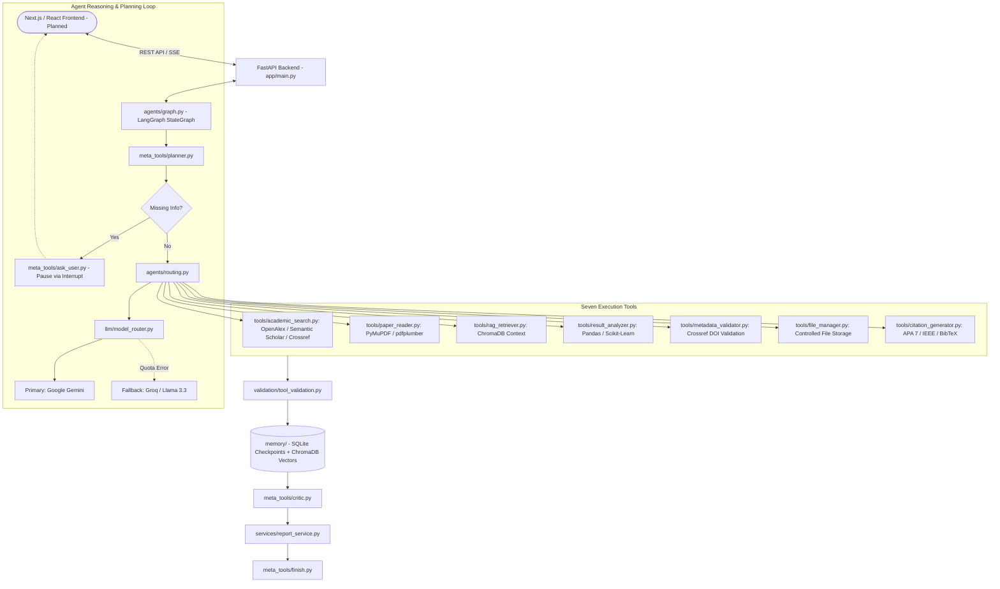

# AIRA — Amharic Intelligent Research Assistant

[](https://www.python.org/downloads/)
[](https://fastapi.tiangolo.com/)
[](https://github.com/langchain-ai/langgraph)
[]()

AIRA (Amharic Intelligent Research Assistant) is an autonomous agentic research assistant designed to support academic research in Amharic Natural Language Processing (NLP) and other low-resource languages. 

AIRA is architected with a **FastAPI backend** orchestrating autonomous agents via **LangGraph**, decoupled from a **Next.js / React frontend** (planned as a separate client component).

---

## 1. System Architecture

AIRA uses an agentic loop governed by a stateful LangGraph engine, exposed through RESTful and streaming endpoints in FastAPI.



### Multi-Provider LLM Resilience
* **Primary LLM**: Google Gemini API (`gemini-3.8-flash` default) for core planning, synthesis, and reflection.
* **Default Fallback LLM**: Groq (`openai/gpt-oss-120b` default) activated automatically on quota exhaustion, rate limits, or provider unavailability.
* **Model Configuration**: Provider names and model IDs are fully configurable via `.env` (`GEMINI_MODEL`, `FALLBACK_PROVIDER`, `GROQ_MODEL`).
* **Degraded Mode**: If all LLM providers become unavailable, AIRA safely continues deterministic tasks (paper retrieval, PDF extraction, metric computation, metadata verification, checkpointing).

### Testing Protocol: Mocked vs. Live
* **Mocked Behavioral Tests (Default CI/Dev)**: Run via `pytest` without needing network access or consuming real API quotas. Mocked tests verify all failure classifications (quota exhaustion, 401 auth errors, 429 rate limits, 503 outages, invalid output), exponential backoff retries, provider switching, and degraded mode.
* **Authenticated Live API Tests**: When credentials are supplied in `.env`, the system connects to live Google GenAI and Groq endpoints with active model verification (`gemini-3.8-flash` and `openai/gpt-oss-120b`). Missing credentials gracefully transition to degraded mode rather than crashing.

---

## 2. Directory Structure

```text
aira/
├── app/                         # FastAPI Backend Application
│   ├── main.py                  # FastAPI entry point & CORS configuration
│   ├── api/                     # API Routers
│   │   └── v1/
│   │       ├── api.py           # V1 Router Aggregator
│   │       └── endpoints/       # Route handlers
│   │           ├── health.py    # Health check endpoint (GET /health)
│   │           ├── research.py  # Research session endpoints
│   │           ├── papers.py    # Paper repository endpoints
│   │           └── reports.py   # Report export endpoints
│   ├── core/                    # Application Configuration
│   │   └── config.py            # Pydantic BaseSettings
│   └── schemas/                 # API Request & Response Schemas
│       ├── health.py
│       └── research.py
├── agents/                      # LangGraph Orchestration
│   ├── graph.py                 # StateGraph workflow definition
│   ├── nodes.py                 # Execution nodes
│   ├── routing.py               # Conditional edges and loops
│   ├── state.py                 # ResearchState TypedDict schema
│   └── prompts.py               # System prompts and templates
├── llm/                         # Multi-Provider LLM Layer
│   ├── model_router.py          # Centralized router & fallback switcher
│   ├── gemini_provider.py       # Google Gemini integration
│   ├── fallback_provider.py     # Groq / OpenRouter fallback
│   ├── provider_errors.py       # Provider status enums & error classes
│   └── usage_tracker.py         # Quota & token tracking
├── tools/                       # Seven Execution Tools
│   ├── academic_search.py       # OpenAlex, Semantic Scholar, Crossref
│   ├── paper_reader.py          # PDF extraction (PyMuPDF / pdfplumber)
│   ├── rag_retriever.py         # ChromaDB vector retrieval
│   ├── result_analyzer.py       # Metrics (F1, Precision, Recall, CER, WER)
│   ├── metadata_validator.py    # DOI & metadata cross-validation
│   ├── file_manager.py          # Sandboxed document persistence
│   └── citation_generator.py    # APA 7, IEEE, BibTeX generation
├── meta_tools/                  # Agent Workflow Management
│   ├── planner.py               # Research plan creator
│   ├── plan_updater.py          # Dynamic plan reviser
│   ├── critic.py                # Evidence & citation critic
│   ├── ask_user.py              # Missing info clarification pause
│   └── finish.py                # Goal completion verification
├── memory/                      # Persistent & Vector Storage
│   ├── database.py              # SQLite session database
│   ├── checkpointing.py         # LangGraph SQLite checkpointing
│   ├── vector_store.py          # ChromaDB collection management
│   └── repositories.py          # Data access queries
├── services/                    # Domain Business Logic
│   ├── evidence_service.py      # Evidence classification
│   ├── report_service.py        # Report synthesis
│   └── embedding_service.py     # Vector embedding abstraction
├── validation/                  # Schema Enforcement & Security
│   ├── tool_validation.py       # Input/output contracts
│   ├── evidence_validation.py   # Citation verification
│   └── schemas.py               # Research query & paper schemas
├── logging_config/              # Observability
│   └── logger.py                # Structured logger
├── data/                        # Persistent Storage (git-ignored)
│   ├── papers/
│   ├── processed/
│   ├── reports/
│   └── chroma/
├── tests/                       # Test Suite
│   ├── test_phase1_setup.py     # Setup & FastAPI health verification
│   ├── test_tools.py
│   ├── test_graph.py
│   ├── test_model_router.py
│   ├── test_api_fallback.py
│   ├── test_memory.py
│   ├── test_reliability.py
│   └── test_prompt_injection.py
├── evaluation/                  # Benchmarks & Metrics
│   ├── test_cases.json
│   └── evaluation_report.md
├── .env.example                 # Environment configuration template
├── .gitignore                   # Ignored files (secrets, venv, data)
├── requirements.txt             # Pinned compatible dependencies
├── README.md                    # Project documentation
└── run.py                       # CLI application launcher & test runner
```

---

## 3. Setup and Installation

### Prerequisites
* macOS (Apple Silicon supported) or Linux.
* **Python 3.11** is recommended for binary wheel compatibility with ChromaDB and ML tools.

### Step 1: Create and Activate Virtual Environment
```bash
# Create virtual environment using Python 3.11
python3.11 -m venv .venv

# Activate virtual environment
source .venv/bin/activate
```

### Step 2: Install Dependencies
```bash
pip install --upgrade pip
pip install -r requirements.txt
```

### Step 3: Configure Environment Variables
```bash
# Copy example configuration
cp .env.example .env

# Edit .env with your credentials (GEMINI_API_KEY, GROQ_API_KEY, etc.)
```

### Step 4: Verify Installation & Health Check
```bash
# Run automated directory and environment verification
python run.py --check

# Run automated test suite (including FastAPI health endpoint tests)
pytest -v
```

### Step 5: Start the FastAPI Backend Server
```bash
# Using run.py launcher
python run.py --server

# Or using uvicorn directly
uvicorn app.main:app --host 127.0.0.1 --port 8000 --reload
```
Once started, explore the interactive API documentation at:
* **Swagger UI**: [http://127.0.0.1:8000/docs](http://127.0.0.1:8000/docs)
* **ReDoc**: [http://127.0.0.1:8000/redoc](http://127.0.0.1:8000/redoc)
* **Health Check**: [http://127.0.0.1:8000/health](http://127.0.0.1:8000/health)

---

## 4. Current Implementation Status

| Phase | Description | Status |
|---|---|---|
| **Phase 1** | **Architecture and Project Setup (FastAPI Backend)** | **Completed & Verified** ✅ |
| **Phase 2** | **LLM Provider Integration & Central Model Router (Gemini + Groq)** | **Completed & Verified** ✅ |
| **Phase 3** | **Academic Search & Metadata Validation Tools (OpenAlex, S2, Crossref)** | **Completed & Verified** ✅ |
| **Phase 4** | **PDF Reading & Information Extraction (PyMuPDF + pdfplumber)** | **Completed & Verified** ✅ |
| **Phase 5** | **RAG & Persistent Memory (SQLite + ChromaDB)** | **Completed & Verified** ✅ |
| Phase 6 | Research Analysis & Metric Tools | Next (Pending Approval) ⏳ |
| Phase 7 | LangGraph Stateful Agent & Meta-Tools | Scheduled 📅 |
| Phase 8 | Reliability, Error Recovery & Degraded Mode | Scheduled 📅 |
| Phase 9 | Structured Logging & Observability | Scheduled 📅 |
| Phase 10 | Frontend API Integration & Next.js Client Interface | Scheduled 📅 |
| Phase 11 | Evaluation, Failure Testing & Submission | Scheduled 📅 |

---

## 5. Phase 3: Academic Search & Metadata Validation

Phase 3 introduces asynchronous multi-provider academic discovery and rigorous multi-registry metadata validation. These tools operate independently of LLM availability and remain 100% operational in Degraded Mode.

### 5.1 Integrated Academic Providers
* **OpenAlex** (`https://api.openalex.org/works`): Broad bibliographic index with inverted index abstract reconstruction and direct open-access URL resolution.
* **Semantic Scholar** (`https://api.semanticscholar.org/graph/v1/paper/search`): High-quality citation counts, publication venue normalization, and paper search.
* **Crossref** (`https://api.crossref.org/works`): Authoritative registration agency for DOIs, official titles, author lists, and container titles. Supports polite pool access via `CROSSREF_MAILTO`.

### 5.2 Search Pipeline & Deduplication
1. **Concurrent Async Fetching**: `tools/academic_search.py` queries configured providers concurrently using `httpx.AsyncClient` with bounded timeouts.
2. **Partial Failure Resilience**: If one or two providers fail (e.g. rate limit, network timeout, upstream 5xx), results from healthy providers are returned alongside clear warnings in `source_errors`. Only if *all* providers fail is an `AcademicSearchAllProvidersFailedError` raised.
3. **Canonical Normalization**:
   - **DOI Normalization**: Strips URLs (`https://doi.org/`, `http://dx.doi.org/`), lowercases, and validates `10.xxxx/...` patterns.
   - **Title Normalization**: Lowercases, removes punctuation, and condenses whitespace.
4. **Deduplication Strategy**:
   - First deduplicates by canonical DOI.
   - Second deduplicates by normalized title + publication year.
   - Merges complementary metadata (combines source provenance, selects richest abstract and open-access links) without inventing missing data.

### 5.3 Metadata Validation Tool
`tools/metadata_validator.py` cross-checks paper metadata against official registry records:
* **Registry Lookup**: Queries Crossref, OpenAlex, and Semantic Scholar by DOI or normalized title.
* **Field-by-Field Verification**:
  - **Title Match**: SequenceMatcher and token Jaccard similarity (≥ 0.80 matches, distinguishing exact titles from subtitles/revisions).
  - **Author Match**: Compares extracted family/surnames across sources (e.g., handles `"Bikila, Abebe"` vs `"Abebe Bikila"`).
  - **Year Tolerance**: Accepts exact matches and ±1-year offsets (common preprint vs. journal publication lags).
* **Validation Statuses**:
  - `VERIFIED`: Confirmed by at least one authoritative registry with consistent title, author, and year.
  - `PARTIALLY_VERIFIED`: Record found in registry, but non-critical differences exist (e.g., subtitle variation or 1-year publication delta).
  - `CONFLICTING`: Record found, but fundamental discrepancies exist (different title or authors).
  - `UNVERIFIED`: Record not found in registries after searching. **Note**: Missing registry records are treated as unverified, never as proof of falsehood.
* **Non-Destructive**: Original paper metadata is strictly preserved; registry findings and field comparisons are returned in an audit payload.

### 5.4 REST API Endpoints
* `POST /api/v1/papers/search`: Search academic papers across providers with optional year filtering, source selection, and deduplication.
* `POST /api/v1/papers/validate`: Validate paper metadata against external registries.
* `GET /api/v1/papers/`: List repository papers or check search tool health.

### 5.5 Environment Configuration
```env
# Phase 3: Academic Search & Registry Configuration
OPENALEX_API_KEY=               # Optional: OpenAlex API key (increased rate limits)
SEMANTIC_SCHOLAR_API_KEY=       # Optional: Semantic Scholar API key
CROSSREF_MAILTO=researcher@example.com  # Polite pool access for Crossref
ACADEMIC_SEARCH_TIMEOUT=15.0    # Per-provider HTTP request timeout (seconds)
ACADEMIC_SEARCH_MAX_RESULTS=20  # Default result cap
ACADEMIC_MAX_RETRIES=2          # Maximum retry attempts on 429/5xx errors
ACADEMIC_INITIAL_BACKOFF_SECONDS=1.0  # Initial exponential backoff delay

# Phase 4: PDF Reading & Security Configuration
MAX_PDF_SIZE_BYTES=31457280     # 30 MB maximum file size
PDF_DOWNLOAD_TIMEOUT=30.0       # Per-document download timeout (seconds)
DEFAULT_EXTRACTION_METHOD=auto  # Engine selection: auto, pymupdf, pdfplumber
```

---

## 6. Phase 4: PDF Reading & Research Paper Information Extraction

Phase 4 introduces autonomous academic paper ingestion from public URLs and local multipart file uploads. It combines a high-performance primary parser (**PyMuPDF**) with a resilient fallback (**pdfplumber**), structured academic dimension extraction, strict 1-indexed page reference tracking, and comprehensive security controls.

### 6.1 Dual-Engine Architecture
* **Primary Engine (`PyMuPDF`)**: Fast C++-backed MuPDF bindings for full-text extraction, block layout parsing, font inspection, and image detection.
* **Fallback Engine (`pdfplumber`)**: Pure-Python pdfminer-based engine activated automatically when PyMuPDF encounters complex encodings, corrupted stream objects, or returns sparse text.
* **Extraction Modes**: Configurable via `extraction_method`:
  - `"auto"`: Attempts PyMuPDF first, falling back to pdfplumber on failure or sparse text.
  - `"pymupdf"`: Forces PyMuPDF parsing.
  - `"pdfplumber"`: Forces pdfplumber parsing.

### 6.2 Structured Academic Information Extraction
AIRA deterministically extracts and organizes core scientific paper dimensions:
- **Core Bibliographic**: Title, Authors, Abstract
- **Research Scope**: Research objectives, Research questions
- **Methodology & Architecture**: Proposed methodology, Dataset, Models and algorithms, Experimental setup
- **Findings & Critique**: Results, Evaluation metrics, Limitations, Future work, Conclusion
- **Strict Grounding Rule**: Missing sections are set to `null` and explicitly tracked in `missing_sections`. Missing data is **never fabricated**.

### 6.3 Verifiable Evidence Provenance
Every extracted finding preserves:
- **`paper_id`**: Canonical document identifier.
- **`page_number`**: Exact 1-indexed physical page where the passage appears.
- **`section_heading`**: True section heading (e.g. `Methodology`, `Results`, `Limitations`).
- **`passage`**: Verbatim extracted supporting passage.
- **`evidence_type`**: Provenance tag (`DIRECT_EXTRACT`, `LLM_SUMMARY`, `INFERENCE`).

### 6.4 Security & Robustness Controls
1. **SSRF Mitigation**: Outbound downloads resolve destination hostnames to IPs and verify them against private (`10.0.0.0/8`, `172.16.0.0/12`, `192.168.0.0/16`), loopback (`127.0.0.0/8`), link-local / cloud metadata (`169.254.169.254`), and non-HTTP schemes. Manual redirect verification prevents open-redirect SSRF bypasses.
2. **Denial of Service Limits**: Enforces `MAX_PDF_SIZE_BYTES` (30 MB) and `PDF_DOWNLOAD_TIMEOUT` (30.0s).
3. **Format Integrity**: Validates `%PDF-` magic header bytes before ingestion.
4. **Scanned Document Detection**: Detects bitmap/image-only PDFs with negligible extractable text and returns `SCANNED_NEEDS_OCR` (`ocr_required: true`), clearly signaling that OCR is required rather than silently reporting empty text.
5. **Prompt Injection Neutralization**: Strips terminal control codes, detects injection patterns (e.g., `"ignore previous instructions"`), flags warnings, and wraps extracts in untrusted content boundaries.

### 6.5 REST API Endpoints
* `POST /api/v1/papers/read`: Download and extract research paper from remote URL.
* `POST /api/v1/papers/upload`: Upload and extract local PDF file (`multipart/form-data`).

---

## 7. Phase 5: Research Context Retrieval (RAG)

Phase 5 introduces a provider-independent Research Context Retrieval system that enables indexing previously read academic papers and retrieving relevant research passages using semantic vector search in ChromaDB.

### 7.1 RAG Architecture & Persistence Design
* **Local ChromaDB Persistence**: Vector embeddings, chunk texts, and metadata are persisted locally in `./data/chroma`.
* **Collection Management**: The `academic_papers` collection utilizes cosine similarity (`{"hnsw:space": "cosine"}`) and explicitly records the embedding model and dimensionality in collection metadata.
* **Model Compatibility Guard**: Re-opening a collection with a different embedding model or dimension triggers `IncompatibleEmbeddingModelError`, preventing corrupted mixed-dimension indexes. Safe collection rebuilds are performed via `vector_store.rebuild_collection(new_model, new_dimension)` preserving raw extractions in `./data/processed/`.
* **Primitive Metadata Normalization**: Flattened metadata values conform to ChromaDB's strict primitive requirements (`str`, `int`, `float`, `bool`), converting author lists into clean strings with lossless decoding upon retrieval.

### 7.2 Document Chunking Strategy
`services/document_chunker.py` provides section-aware, page-preserving document splitting:
1. **Section-Aware Partitioning**: Groups text by recognized academic sections (`Abstract`, `Methodology`, `Results`, `Conclusion`, etc.).
2. **Page-Boundary Preservation**: Tracks exact physical page intervals (`page_start`, `page_end`) for every chunk using raw page coordinate mapping.
3. **Boundary Integrity**: Chunks split cleanly at sentence (`. `, `\n`) or paragraph boundaries without slicing words in half.
4. **Deterministic Chunk Identifiers**: Generates stable chunk IDs formatted as `{paper_id}_c{index:04d}`.
5. **Fallback for Unsectioned Documents**: Falls back to page-by-page sequential paragraph chunking for papers without standard section headings.

### 7.3 Embedding Provider Abstraction & Model Migration
Decoupled completely from the Gemini/Groq model router:
* **`BaseEmbeddingProvider`**: Abstract interface enforcing `embed_documents()` batching, `embed_query()`, dimensionality validation, and numerical checks (rejecting `NaN` and `Inf`). Exposes `is_synthetic: bool`.
* **`GeminiEmbeddingProvider`**: Uses **`gemini-embedding-2`** with explicit `output_dimensionality` configuration (`EMBEDDING_DIMENSION = 768`). Validates returned dimensions directly from API responses.
* **`MockEmbeddingProvider`**: Generates deterministic unit-normalized pseudo-embeddings from SHA-256 hashes for development and offline test environments with **zero live API quota consumption**. Explicitly flagged with `is_synthetic = True`.
* **Production Deployment Safety**: In production (`ENVIRONMENT="production"`), `MockEmbeddingProvider` is strictly rejected unless `ALLOW_MOCK_EMBEDDINGS=true`.
* **`NullEmbeddingProvider`**: Used when `EMBEDDING_PROVIDER="none"`. Explicitly flags semantic search as unavailable rather than pretending keyword search is semantic search.

### 7.4 Indexing & Retrieval Tools
* **`index_research_paper(paper_id)`**:
  - Retrieves previously extracted paper from `services/paper_repository.py` (`./data/processed/{paper_id}.json`).
  - Verifies text usability (rejects empty or un-OCRed scanned documents with `UnusablePaperTextError`).
  - Chunks document and generates batch embeddings.
  - **True Atomic Replacement & Rollback**: Backs up existing records for the paper before replacement. If chunk addition fails or crashes, previous chunks are automatically restored from the snapshot.
* **`retrieve_research_context(question, paper_ids, top_k)`**:
  - Generates query embedding and performs similarity search in ChromaDB.
  - Filters by specific `paper_ids` when requested.
  - Normalizes cosine distance to similarity score in `[0.0, 1.0]`.
  - Propagates `is_synthetic: bool` in both `RetrievalResultSchema` and `RetrievedContextItemSchema` so mock results are never misrepresented as live semantic search.
  - Encloses retrieved passages inside `<untrusted_academic_content>` tags for prompt injection defense.

### 7.5 Retrieval Quality Evaluation Benchmark
`evaluation/retrieval_eval.py` provides a reproducible benchmark dataset:
* Includes realistic Amharic and English academic research queries.
* Ground truth page references and target paper IDs alongside negative distractor papers (Computer Vision, Healthcare NLP).
* Computes `Recall@5`, `Precision@5`, `CorrectPaperRate`, and `CorrectPageRate`.
* Clearly differentiates mock evaluation from live Gemini evaluation.

### 7.6 REST API Endpoints
* `GET /api/v1/papers/`: List all extracted and indexed papers and total chunk counts.
* `POST /api/v1/papers/{paper_id}/index`: Index extracted paper chunks into ChromaDB.
* `POST /api/v1/papers/retrieve`: Retrieve relevant academic research passages (includes `is_synthetic` indicator).
* `GET /api/v1/papers/{paper_id}/indexing-status`: Inspect ChromaDB indexing status for a paper.
* `DELETE /api/v1/papers/{paper_id}/index`: Delete a paper's indexed vector chunks.

## 8. Phase 6: Research Analysis and Comparison

Phase 6 introduces a rigorous academic research comparison, methodology breakdown, deterministic quantitative evaluation, evidence-supported gap identification, and structured multi-format report synthesis system.

### 8.1 Multi-Paper Matrix Comparison (`compare_research_papers`)
* **12 Standardized Dimensions**: Systematically compares papers across:
  1. *Research Objectives*
  2. *Research Questions*
  3. *Methodology*
  4. *Datasets*
  5. *Dataset Sizes*
  6. *Languages Covered*
  7. *Models and Algorithms*
  8. *Experimental Setup*
  9. *Evaluation Metrics*
  10. *Reported Results*
  11. *Limitations*
  12. *Future Work*
* **Anti-Fabrication Policy**: Missing dimensions are never invented or hallucinated; they are explicitly represented as `None` / `"Not reported"`.
* **Discrepancy Highlighting**: Differences across experimental setups, datasets, and objectives are highlighted deterministically.

### 8.2 Methodology Breakdown (`analyze_research_methodology`)
* **Core Methodological Facets**: Dissects papers into:
  - *Research Design*
  - *Data Collection and Corpus Construction*
  - *Data Preprocessing & Tokenization*
  - *Model Architecture*
  - *Training Procedure and Compute Budget*
  - *Evaluation Protocol*
* **Strict Evidence Classification**: Every finding is stamped with an explicit `evidence_type`:
  - `DIRECT_EXTRACT`: Verbatim citation from paper text with page references.
  - `LLM_ANALYSIS` / `INFERENCE`: Synthesized methodological deduction clearly demarcated from direct quotes.
* **Reproducibility Assessment**: Scores reproducibility (`HIGH`, `MEDIUM`, `LIMITED`) based on reported hyperparameters, dataset availability, and code repository links.

### 8.3 Deterministic Quantitative Results Analysis (`analyze_experimental_results`)
* **Pure Python/Pandas Processing**: Statistical ranking, delta calculation, and compatibility checks are performed entirely in Python/Pandas without LLM numerical hallucination risk.
* **Unit Normalization & Scale Alignment**: Converts fractions (`0.0 - 1.0`) into standard percentage scales (`0.0 - 100.0%`) where applicable while preserving raw strings.
* **Directionality Enforcement**:
  - `HIGHER_IS_BETTER`: Accuracy, F1, BLEU, ROUGE, Precision, Recall, AUC.
  - `LOWER_IS_BETTER`: Word Error Rate (WER), Character Error Rate (CER), Loss, Perplexity.
* **Mathematical Incompatibility Detection**:
  - Distinguishes incompatible metric variants (e.g., Macro-F1 vs Micro-F1).
  - Flags metric tables as `INCOMPATIBLE`, documents the mathematical rationale, and suppresses misleading direct model rankings.
* **Statistical Rigor & Variance Alerts**: Explicitly warns when papers omit standard deviation, confidence intervals (`±`), or hypothesis testing p-values.

### 8.4 Evidence-Backed Research Gaps (`identify_research_gaps`)
* **Structured Gap Taxonomy**:
  - `AUTHOR_ACKNOWLEDGED_GAP`: Stated directly in the paper's Limitations or Future Work sections with page citations.
  - `CROSS_PAPER_GAP`: Unaddressed inconsistencies, unshared evaluation benchmarks, or contradictory findings across multiple papers.
  - `POTENTIAL_RESEARCH_DIRECTION`: Evidence-supported avenues for future research synthesized from the corpus.
* **Corpus Bounding Disclaimer**: Every gap report includes an explicit disclaimer stating that gaps are strictly derived from the analyzed corpus and do not imply global literature nonexistence.

### 8.5 Comprehensive Report Synthesis & Export (`services/report_service.py`)
Generates structured comparison reports adhering to the standard 11-section publication format:
1. Research Question
2. Papers Analyzed
3. Comparison of Objectives and Methodologies
4. Dataset Comparison
5. Model & Architecture Comparison
6. Experimental Results Comparison (with Markdown tables and ranking deltas)
7. Strengths and Limitations
8. Identified Research Gaps (with page-level evidence quotes)
9. Evidence-Backed Conclusions
10. Missing Information & Limitations of the Analysis
11. References to Original Papers

* **Multi-Format Export**:
  - **Markdown (`export_report_markdown`)**: Publication-ready Markdown formatted with GitHub Flavored Markdown tables and callouts.
  - **JSON (`export_report_json`)**: Strictly validated Pydantic schema for programmatic downstream integration.

### 8.6 Degraded Mode & High Reliability
* **Zero-Quota Offline Operation**: All comparison tools operate deterministically when `model_router.is_degraded_mode() == True`.
* **Graceful Fallback**: If LLMs are unavailable or quota is exhausted, comparison matrices, metric extraction, reproducibility scoring, and gap analyses continue to generate accurate, factual results using deterministic heuristics.
* Reports generated in degraded mode carry prominent header notices informing users of offline generation.

### 8.7 REST API Endpoints
* **Research Analysis**:
  - `POST /api/v1/research/compare`: Compare multiple papers across 12 dimensions.
  - `GET /api/v1/research/methodology/{paper_id}`: Detailed methodology breakdown and reproducibility evaluation.
  - `POST /api/v1/research/results`: Numerical experimental analysis with Pandas ranking and compatibility guards.
  - `POST /api/v1/research/gaps`: Evidence-backed research gap identification.
* **Research Reports**:
  - `POST /api/v1/reports/comparison`: Generate complete 11-section comparison report.
  - `GET /api/v1/reports/{report_id}`: Retrieve stored comparison report.
  - `GET /api/v1/reports/{report_id}/export?format=markdown|json`: Export report as Markdown or JSON.


