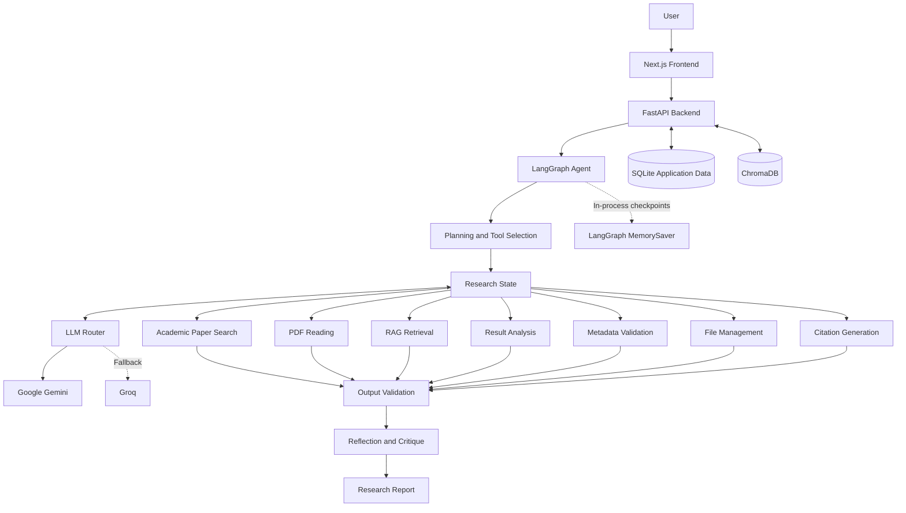

# AIRA — Amharic Intelligent Research Assistant

AIRA is an agentic AI research assistant designed to help users discover academic papers, read research PDFs, retrieve relevant evidence, compare research findings, analyze experimental results, and generate academic citations.

Built with **FastAPI, LangGraph, Google Gemini, Groq, ChromaDB, and Next.js**, AIRA combines LLM-powered reasoning with deterministic research tools and validation mechanisms.

## Project Status

**Core implementation and Phase 9 evaluation completed.**

Key capabilities include:

- Stateful agent orchestration using LangGraph.
- Academic paper discovery through OpenAlex, Semantic Scholar, and Crossref.
- Cross-registry academic metadata validation.
- PDF upload, downloading, text extraction, and section parsing.
- Research retrieval using ChromaDB.
- Experimental result analysis and paper comparison.
- APA 7, IEEE, and BibTeX citation generation.
- LLM provider fallback and deterministic degraded mode.
- A Next.js and React frontend.
- An offline evaluation suite covering six evaluation areas.

---

## 1. Architecture

AIRA uses a stateful agent workflow. LangGraph manages research state, planning, tool selection, execution, validation, reflection, and report generation.



### Agent workflow

The agent can:

1. Receive and interpret a research request.
2. Identify missing information and ask the user for clarification.
3. Create and revise a research plan.
4. Select tools based on the current task.
5. Execute tools and validate their outputs.
6. Retry failed operations with corrected inputs, within configured limits.
7. Store relevant evidence and reflect on findings.
8. Critique results and generate a final research report.

The workflow supports conditional routing and adaptive decisions rather than relying on a fixed sequence of operations.

### LLM routing and degraded mode

AIRA supports two language-model providers:

| Provider      | Role     | Default model         |
| ------------- | -------- | --------------------- |
| Google Gemini | Primary  | `gemini-3.8-flash`    |
| Groq          | Fallback | `openai/gpt-oss-120b` |

When the primary provider encounters quota exhaustion, authentication errors, or service failures, the router can switch to the fallback provider.

If both providers are unavailable, AIRA enters degraded mode. LLM-dependent reasoning may be unavailable, but supported deterministic operations can continue without requiring an LLM response.

---

## 2. Research Tools

AIRA provides seven execution tools:

| Tool                  | Purpose                                                |
| --------------------- | ------------------------------------------------------ |
| Academic Paper Search | Searches OpenAlex, Semantic Scholar, and Crossref      |
| PDF Reading           | Extracts text and sections from research papers        |
| RAG Retrieval         | Retrieves relevant research passages using ChromaDB    |
| Result Analysis       | Analyzes and compares experimental metrics             |
| Metadata Validation   | Cross-checks paper metadata across academic registries |
| File Management       | Organizes research files and generated content         |
| Citation Generation   | Generates APA 7, IEEE, and BibTeX citations            |

### Meta-tools

The agent also uses meta-tools for:

- Research planning and plan revision.
- Asking the user for clarification.
- Critiquing findings.
- Selecting and coordinating tools.
- Finishing research tasks.

---

## 3. Technology Stack

### Backend and agent orchestration

- Python 3.11
- FastAPI
- LangGraph
- LangChain
- Pydantic

### AI and language models

- Google Gemini
- Groq

### Academic research

- OpenAlex
- Semantic Scholar
- Crossref

### Document processing and retrieval

- PyMuPDF
- pdfplumber
- ChromaDB

### Data and evaluation

- SQLite
- Pandas
- NumPy
- scikit-learn
- pytest

### Frontend

- Next.js
- React
- TypeScript
- Tailwind CSS

---

## 4. Project Structure

```text
AIRA/
├── agents/              # LangGraph agent workflow
├── app/                 # FastAPI application and API routes
├── data/                # Application and research data
├── evaluation/          # Benchmarks, evaluators, and reports
├── frontend/            # Next.js frontend
├── llm/                 # LLM providers, fallback, and model router
├── logging_config/      # Logging configuration
├── memory/              # Research memory and retrieval support
├── meta_tools/          # Planning, critique, and coordination tools
├── scripts/             # Utility scripts
├── services/            # Application services
├── tests/               # Automated tests
├── tools/               # Research execution tools
├── validation/          # Output and evidence validation
├── .env.example         # Environment variable template
├── requirements.txt     # Python dependencies
├── run.py               # Backend launcher
└── README.md
```

---

## 5. Requirements

- Python 3.11 (recommended).
- Node.js and npm.
- Git.
- API credentials for the configured LLM providers.

Academic search providers may have different rate limits. AIRA handles supported provider failures through bounded retries and fallback behavior.

---

## 6. Installation and Setup

### 6.1 Clone the repository

```bash
git clone https://github.com/yeezyyoba/AIRA.git
cd AIRA
```

### 6.2 Backend setup

Create and activate a Python virtual environment:

```bash
python3.11 -m venv .venv
source .venv/bin/activate
```

Install dependencies:

```bash
pip install -r requirements.txt
```

Create the environment configuration file:

```bash
cp .env.example .env
```

Add the required API credentials and configuration values to `.env`.

**Important:** Never commit `.env` or expose API keys in public repositories.

### 6.3 Frontend setup

Open another terminal and navigate to the frontend directory:

```bash
cd frontend
npm ci
```

Create the frontend environment file:

```bash
cp .env.example .env.local
```

The default backend API URL is:

```env
NEXT_PUBLIC_API_URL=http://localhost:8000
```

---

## 7. Running AIRA

### 7.1 Start the backend

From the project root, activate the virtual environment and check the environment:

```bash
python run.py --check
```

Start the FastAPI server:

```bash
python run.py --server
```

The backend runs at:

```text
http://localhost:8000
```

API documentation:

- Swagger UI: http://localhost:8000/docs
- ReDoc: http://localhost:8000/redoc
- Health endpoint: http://localhost:8000/health

### 7.2 Start the frontend

In another terminal:

```bash
cd frontend
npm run dev
```

Open the frontend at:

```text
http://localhost:3000
```

---

## 8. Evaluation

AIRA includes an offline evaluation framework with six benchmark areas:

1. Academic paper search.
2. PDF extraction.
3. RAG retrieval.
4. Research analysis and comparison.
5. Agentic behavior.
6. Reliability and failure handling.

The evaluation uses deterministic fixtures and mocked external services where appropriate. Results should be interpreted within the scope of those test conditions.

### 8.1 Evaluation results

| Evaluation area  |         Result | Interpretation                            |
| ---------------- | -------------: | ----------------------------------------- |
| Academic Search  |      P@5: 0.62 | Controlled benchmark candidate pool       |
| Academic Search  | Recall@5: 1.00 | Relevant benchmark candidates retrieved   |
| Academic Search  |    MRR: 0.8667 | Ranking performance                       |
| Academic Search  |   nDCG: 0.8546 | Ranking quality                           |
| PDF Extraction   |         0.8889 | Digital PDF field extraction accuracy     |
| PDF Extraction   |           100% | Page-count and OCR-required flag accuracy |
| RAG Retrieval    |           100% | Correct-paper rate                        |
| RAG Retrieval    |            50% | Correct-page rate                         |
| Analysis         |            5/5 | Component challenge cases passed          |
| Agentic Behavior |            6/6 | Node and routing checks passed            |
| Reliability      |            4/4 | Narrow fault-injection checks passed      |

### 8.2 RAG evaluation details

The RAG benchmark contains eight questions:

- Six evaluated questions.
- Two scanned-document questions excluded because OCR is not implemented.

The evaluation used synthetic documents and a mock embedding provider. It verifies retrieval plumbing and benchmark behavior, not production semantic retrieval quality.

For the six evaluated questions:

| Metric                             | Result |
| ---------------------------------- | -----: |
| Correct-paper rate                 |   1.00 |
| Correct-page rate                  |   0.50 |
| Page precision@5                   |   0.10 |
| Page recall                        |   0.50 |
| Keyword recall proxy               |   0.50 |
| Ground-truth passage support proxy |   0.50 |
| Unsupported passage proxy          |   0.50 |

### 8.3 Automated testing

The last recorded full backend regression suite completed with:

**197 tests passed, 7 warnings.**

The frontend production build also completed successfully during Phase 8 verification.

These are recorded verification results, not a claim that every subsequent change has been retested.

### 8.4 Evaluation report

The detailed evaluation report is available at:

```text
evaluation/evaluation_report.md
```

It includes benchmark descriptions, metric definitions, results, failure analysis, limitations, and recommendations.

---

## 9. Known Limitations

AIRA has several documented limitations:

- **OCR:** Scanned PDFs are detected, but OCR transcription is not implemented.
- **RAG evaluation:** The reported benchmark uses mock embeddings and does not establish production semantic retrieval quality.
- **Graph persistence:** LangGraph currently uses the in-process `MemorySaver` checkpoint mechanism; graph checkpoints are not durable across process restarts.
- **PDF extraction:** Complex layouts and tables may produce imperfect text ordering.
- **Evidence validation:** Automated claim-grounding checks are heuristic and cannot replace expert review.
- **Evaluation scope:** Several evaluation results measure individual components or routing behavior rather than complete real-world research tasks.
- **External provider availability:** Academic search and LLM services remain subject to network availability, rate limits, and API quotas.

---

## 10. Future Improvements

Potential improvements include:

- Integrating OCR for scanned research documents.
- Evaluating retrieval with real production embeddings.
- Expanding bilingual Amharic and English RAG benchmarks.
- Improving claim-level evidence verification.
- Adding durable LangGraph checkpoint persistence.
- Expanding end-to-end agent evaluation.
- Testing against a larger collection of real academic papers.
- Improving PDF table and complex-layout extraction.

---

## 11. Security and Configuration

- Store API keys in environment variables.
- Keep `.env` and `.env.local` out of version control.
- Validate external URLs and downloaded documents.
- Apply file-size and request-time limits.
- Treat retrieved academic documents as untrusted input.
- Validate tool outputs before using them in subsequent agent steps.

---

## 12. License

Add the appropriate license information here before distributing the project publicly.

---

**AIRA — Amharic Intelligent Research Assistant**
_An agentic AI system for academic research, evidence retrieval, and scientific analysis._
