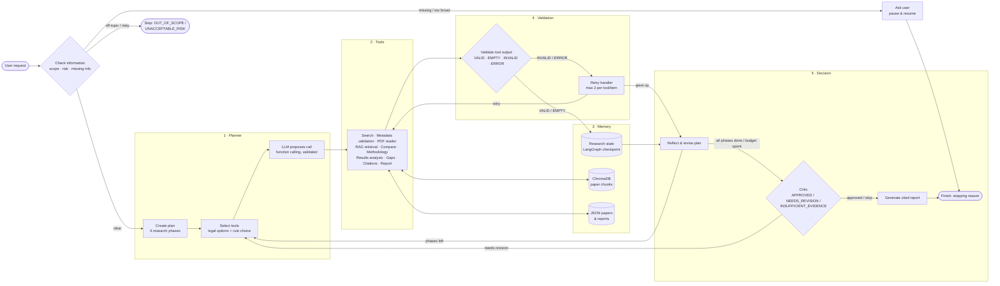

# AIRA — Amharic Intelligent Research Assistant

AIRA is an agentic AI research assistant designed to help users discover academic papers, read research PDFs, retrieve relevant evidence, compare research findings, analyze experimental results, and generate academic citations.

Built with **FastAPI, LangGraph, Google Gemini, Groq, ChromaDB, and Next.js**, AIRA combines LLM-powered reasoning with deterministic research tools and validation mechanisms.

## Project Status

**Core implementation and Phase 9 evaluation completed.**

Key capabilities include:

- Stateful agent orchestration using LangGraph.
- Academic paper discovery through OpenAlex, Semantic Scholar, and Crossref.
- Cross-registry academic metadata validation.
- PDF upload, downloading, text extraction, and section parsing.
- Research retrieval using ChromaDB.
- Experimental result analysis and paper comparison.
- APA 7, IEEE, and BibTeX citation generation.
- Hybrid tool selection: the LLM proposes the next tool call with native function calling, and code validates it before anything runs.
- LLM provider fallback, rate-limit cooldowns, and deterministic degraded mode.
- Per-session API usage reporting (LLM, embeddings, academic APIs) in the API and the UI.
- A Next.js and React frontend.
- An offline evaluation suite covering six evaluation areas.

---

## 1. Architecture

### 1.1 Agent pattern

AIRA is a **plan-and-execute agent with reflection and self-correction**, built as a LangGraph `StateGraph`:

* **Plan:** a planner meta-tool turns the request into a six-phase research plan (search & validate → extract & index → compare & analyse (incl. RAG retrieval) → identify gaps → cite → synthesise report).
* **Execute:** each loop picks one tool. The rules list the legal options for the current phase, the LLM proposes one via **function calling**, and code validates the proposal ("the model proposes, the code disposes").
* **Observe and validate:** every tool output is validated before it can enter the state as evidence.
* **Reflect and correct:** failures go to a bounded retry handler, reflection can revise the plan (e.g. expand the search), and a critic decides whether the evidence supports the goal or another loop is needed.
* **Stop:** explicit stopping rules (section 1.5) always end the graph.

### 1.2 Architecture diagram (planner → tools → memory → validation → decision)



The full component view (frontend, API, LLM router, storage) is in [ARCHITECTURE.md](ARCHITECTURE.md).

### 1.3 Workflow (LangGraph nodes)

| Node | What it does | Next |
| --- | --- | --- |
| `receive_request`, `analyze_goal` | Normalise the query, derive goal, domain and search query | `check_information` |
| `check_information` | Scope check, risk check, missing-information check | `ask_user`, `finish_task` (refusal) or `create_plan` |
| `ask_user` | Pause with a clarification question; the session resumes with the answer | `finish_task` (paused) |
| `create_plan` | Planner meta-tool builds the phase plan | `select_tools` |
| `select_tools` | Lists the legal tool calls for the current phase; the first is the rule choice | `propose_tool_call` (LLM mode), `execute_tools` (rules mode) or `reflect_and_revise` |
| `propose_tool_call` | LLM proposes one call via function calling; code validates tool, arguments, ids and limits, else uses the rule choice | `execute_tools` |
| `execute_tools` | Runs the chosen tool | `validate_tool_outputs` |
| `validate_tool_outputs` | VALID / EMPTY / INVALID / ERROR | `retry_handler` or `store_evidence` |
| `retry_handler` | Bounded retry with corrected inputs | `execute_tools` or `reflect_and_revise` |
| `store_evidence` | Admits validated output to the state; updates phase status | `reflect_and_revise` |
| `reflect_and_revise` | Explains progress; may revise the plan (e.g. expand the search) | `select_tools` (loop) or `critique_findings` |
| `critique_findings` | Critic checks the evidence against the goal | `select_tools` (revision loop) or `generate_report` |
| `generate_report`, `finish_task` | Cited report; final stopping reason | end |

Every node appends a log entry with its decision and a one-line reason (`observable_logs`), shown live in the UI.

### 1.4 State

The agent's memory for a run is a typed `ResearchState` (`agents/state.py`), checkpointed by LangGraph per session so a paused session can resume:

| Group | Fields (main ones) |
| --- | --- |
| Request | `query`, `research_goal`, `search_query`, `domain`, `year_from`/`year_to`, `max_results` |
| Plan & control | `research_plan`, `completed_tasks`, `current_task`, `phase_statuses`, `step_count`/`max_steps`, `stopping_reason` |
| Tool selection | `tool_options`, `selected_tool`, `tool_inputs`, `tool_selection`, `tool_selection_stats`, `llm_proposals_paused` |
| Retries & dedup | `retry_counts`, `failed_items`, `executed_tool_signatures`, `successful_tool_signatures` |
| Evidence | `discovered_papers`, `validated_papers`, `extracted_papers`, `indexed_papers`, `retrieved_evidence`, `metric_comparisons`, `methodology_analyses`, `paper_comparisons`, `identified_gaps`, `citations` |
| Reflection | `reflections`, `plan_revisions`, `critique_status`, `observable_logs` |
| Safety & clarification | `risk_flags`, `security_flags`, `missing_information`, `clarification_question`, `user_message` |

Long-term memory outside the state: extracted papers as JSON (`data/processed/`), their chunks in ChromaDB (`data/chroma/`), and reports in `data/reports/`.

### 1.5 Stopping rules

The graph always terminates with one of these statuses:

| Status | When |
| --- | --- |
| `GOAL_ACHIEVED` | The critic approves and at least two papers were extracted |
| `PARTIAL` | Some evidence was gathered but the critic did not approve it |
| `INSUFFICIENT_EVIDENCE` | No paper could be extracted, or the critic found the evidence insufficient |
| `USER_CLARIFICATION_REQUIRED` | Essential information is missing or the topic is too broad; the run pauses until the user answers |
| `UNACCEPTABLE_RISK` | The request tries to override instructions, asks for secrets or destructive actions, or asks to fabricate evidence; no tool runs |
| `OUT_OF_SCOPE` | The request is not about language research (e.g. football results); no tool runs |
| `MAX_STEPS_REACHED` | The step budget (`MAX_AGENT_STEPS`, default 150 node executions) is spent; a bounded partial report is written |

### 1.6 Retries

* At most **`MAX_RETRIES` = 2** retries, counted per tool **and** per item (one failing PDF does not use up the retries of another).
* Only transient failures are retried (timeouts, network errors, HTTP 5xx, 408, 429). Permanent failures (HTTP 404, "not a valid PDF") are recorded once and skipped.
* An empty first search is retried with a reformulated query; after the retries are spent the agent moves on and reflects instead of looping.
* Identical calls that already succeeded are never repeated (tool signatures are deduplicated).

### 1.7 Fallbacks

| Situation | Fallback |
| --- | --- |
| LLM tool proposal invalid (unknown/illegal tool, bad arguments, URL injection, out-of-scope query) | Code rejects it and uses the rule-based choice |
| LLM proposal times out or the provider fails | Rule-based choice; after 2 consecutive failures, LLM proposals pause for the rest of the run |
| Gemini fails (quota, 429, 503, timeout) | Groq (`openai/gpt-oss-120b`), then NVIDIA (`openai/gpt-oss-120b` on build.nvidia.com) if `NVIDIA_API_KEY` is set |
| A provider returns 429 / 503 | It is paused for its own "retry in N s" hint (max 30 s) and requests go to the other provider |
| Every LLM provider down | **Degraded mode**: deterministic tools (search, PDF extraction, DOI validation, metrics, citations) continue; reasoning steps use rules |
| Semantic Scholar rate limit | Requests are spaced 1.1 s apart; Semantic Scholar is skipped when Crossref and OpenAlex already agree |
| PDF link is a landing page | Direct PDF links (`.pdf`, arXiv, ACL Anthology) are tried first |
| Report generation fails | A clearly labelled `PARTIAL` report that states what is unknown |

| Provider | Role | Default model |
| --- | --- | --- |
| Google Gemini | Primary | `gemini-3.8-flash` |
| Groq | Fallback 1 | `openai/gpt-oss-120b` |
| NVIDIA (build.nvidia.com, optional) | Fallback 2 | `openai/gpt-oss-120b` (`NVIDIA_MODEL`) |

---

## 2. Research Tools

### 2.1 Execution tools

Ten execution tools, each with a function-calling spec (name, when-to-use description, JSON schema) in `agents/tool_calling.py`:

| Tool | Category (assignment) | Purpose |
| --- | --- | --- |
| `search_academic_papers` | Search | OpenAlex, Semantic Scholar and Crossref, merged and deduplicated |
| `validate_metadata_integrity` | Function calling | Cross-checks title, authors, year and DOI across registries (VERIFIED needs two) |
| `read_research_paper` | System & environment | Downloads (SSRF-protected) and extracts PDF text and sections |
| `retrieve_research_context` | RAG | Retrieves passages with page citations from ChromaDB |
| `compare_research_papers` | Code & compute | Compares objectives, datasets, models across papers |
| `analyze_research_methodology` | Code & compute | Extracts and compares methodologies |
| `analyze_experimental_results` | Code & compute | Extracts metrics (accuracy, F1, BLEU, WER, …) and compares compatible results |
| `identify_research_gaps` | Code & compute | Author-acknowledged limitations and gaps |
| `generate_citations` | Code & compute | APA 7, IEEE and BibTeX from validated metadata, never invented fields |
| `generate_research_comparison_report` | System & environment | Builds and saves the cited report (file manager) |

### 2.2 Meta-tools

Meta-tools act on the agent's own process rather than the outside world. Each one is a plain function in `meta_tools/` or `agents/`; the LangGraph node that uses it only logs the decision and updates the state.

| Meta-tool | File | Used by node(s) | What it decides |
| --- | --- | --- | --- |
| Planner | `meta_tools/planner.py` | `create_plan` | The six-phase research plan; recognizes work already done on resumed sessions |
| Plan updater | `meta_tools/plan_updater.py` | `store_evidence`, `reflect_and_revise` | Checks off, blocks or re-opens phases; revises the plan to expand the search |
| Ask user | `meta_tools/ask_user.py` | `check_information`, `ask_user` | Whether the topic is missing or too broad, out of scope, or an unacceptable risk |
| Tool selection | `agents/tool_calling.py` | `select_tools`, `propose_tool_call` | Legal next calls, the LLM's proposal, and whether code accepts it |
| Critic | `meta_tools/critic.py` | `critique_findings` | APPROVED, NEEDS_REVISION or INSUFFICIENT_EVIDENCE |
| Finish | `meta_tools/finish.py` | `finish_task` | The final stopping reason |

### 2.3 Validation and evidence

Every tool output is checked by `validation/tool_validation.py` (VALID, EMPTY, INVALID or ERROR) before the agent trusts it; INVALID and ERROR route to the retry handler. `validation/evidence_validation.py` decides what may enter the research state as evidence (no output from failed calls, no unusable extractions) and flags prompt-injection text found inside papers. Report conclusions cite the paper and page they come from, and references use registry-verified metadata.

---

## 3. Technology Stack

### Backend and agent orchestration

- Python 3.11
- FastAPI
- LangGraph
- LangChain
- Pydantic

### AI and language models

- Google Gemini
- Groq

### Academic research

- OpenAlex
- Semantic Scholar
- Crossref

### Document processing and retrieval

- PyMuPDF
- pdfplumber
- ChromaDB

### Data and evaluation

- Local JSON storage (SQLite configured, not yet used)
- Pandas
- NumPy
- scikit-learn
- pytest

### Frontend

- Next.js
- React
- TypeScript
- Tailwind CSS

---

## 4. Project Structure

```text
AIRA/
├── agents/              # LangGraph workflow: graph.py (wiring), nodes.py (steps), routing.py (conditional edges), state.py, prompts.py
├── app/                 # FastAPI application and API routes
├── data/                # Application and research data
├── evaluation/          # Benchmarks, evaluators, and reports
├── frontend/            # Next.js frontend
├── llm/                 # LLM providers, fallback, and model router
├── logging_config/      # Logging configuration
├── memory/              # Research memory and retrieval support
├── meta_tools/          # Planner, plan updater, ask user, critic, finish
├── scripts/             # Utility scripts
├── services/            # Application services
├── tests/               # Automated tests
├── tools/               # Research execution tools
├── validation/          # Pydantic schemas, tool-output validation, evidence rules
├── .env.example         # Environment variable template
├── requirements.txt     # Python dependencies
├── run.py               # Backend launcher
└── README.md
```

---

## 5. Requirements

- Python 3.11 (recommended).
- Node.js and npm.
- Git.
- API credentials for the configured LLM providers.

Academic search providers may have different rate limits. AIRA handles supported provider failures through bounded retries and fallback behavior.

---

## 6. Installation and Setup

### 6.1 Clone the repository

```bash
git clone https://github.com/yeezyyoba/AIRA.git
cd AIRA
```

### 6.2 Backend setup

Create and activate a Python virtual environment:

```bash
python3.11 -m venv .venv
source .venv/bin/activate
```

Install dependencies:

```bash
pip install -r requirements.txt
```

Create the environment configuration file:

```bash
cp .env.example .env
```

Add the required API credentials and configuration values to `.env`.

**Important:** Never commit `.env` or expose API keys in public repositories.

### 6.3 Frontend setup

Open another terminal and navigate to the frontend directory:

```bash
cd frontend
npm ci
```

Create the frontend environment file:

```bash
cp .env.example .env.local
```

The default backend API URL is:

```env
NEXT_PUBLIC_API_URL=http://localhost:8000
```

---

## 7. Running AIRA

### 7.1 Start the backend

From the project root, activate the virtual environment and check the environment:

```bash
python run.py --check
```

Start the FastAPI server:

```bash
python run.py --server
```

The backend runs at:

```text
http://localhost:8000
```

API documentation:

- Swagger UI: http://localhost:8000/docs
- ReDoc: http://localhost:8000/redoc
- Health endpoint: http://localhost:8000/health

### 7.2 Start the frontend

In another terminal:

```bash
cd frontend
npm run dev
```

Open the frontend at:

```text
http://localhost:3000
```

---

## 8. Evaluation

AIRA includes an offline evaluation framework with six benchmark areas:

1. Academic paper search.
2. PDF extraction.
3. RAG retrieval.
4. Research analysis and comparison.
5. Agentic behavior.
6. Reliability and failure handling.

The evaluation uses deterministic fixtures and mocked external services where appropriate. Results should be interpreted within the scope of those test conditions.

### 8.1 Evaluation results

| Evaluation area  |         Result | Interpretation                            |
| ---------------- | -------------: | ----------------------------------------- |
| Academic Search  |      P@5: 0.62 | Controlled benchmark candidate pool       |
| Academic Search  | Recall@5: 1.00 | Relevant benchmark candidates retrieved   |
| Academic Search  |    MRR: 0.8667 | Ranking performance                       |
| Academic Search  |   nDCG: 0.8546 | Ranking quality                           |
| PDF Extraction   |         0.8889 | Digital PDF field extraction accuracy     |
| PDF Extraction   |           100% | Page-count and OCR-required flag accuracy |
| RAG Retrieval    |           100% | Correct-paper rate                        |
| RAG Retrieval    |            50% | Correct-page rate                         |
| Analysis         |            5/5 | Component challenge cases passed          |
| Agentic Behavior |            6/6 | Node and routing checks passed            |
| Reliability      |            4/4 | Narrow fault-injection checks passed      |

### 8.2 RAG evaluation details

The RAG benchmark contains eight questions:

- Six evaluated questions.
- Two scanned-document questions excluded because OCR is not implemented.

The evaluation used synthetic documents and a mock embedding provider. It verifies retrieval plumbing and benchmark behavior, not production semantic retrieval quality.

For the six evaluated questions:

| Metric                             | Result |
| ---------------------------------- | -----: |
| Correct-paper rate                 |   1.00 |
| Correct-page rate                  |   0.50 |
| Page precision@5                   |   0.10 |
| Page recall                        |   0.50 |
| Keyword recall proxy               |   0.50 |
| Ground-truth passage support proxy |   0.50 |
| Unsupported passage proxy          |   0.50 |

### 8.3 Automated testing

The last recorded full backend regression suite (4 Nov 2026) completed with:

**464 tests passed** (Python 3.11), run with `python -m pytest tests`. This includes 18 end-to-end
graph scenarios (`tests/test_graph.py`), the LLM function-calling tests (`tests/test_tool_calling.py`),
the rate-limit and API-usage tests (`tests/test_rate_limits.py`) and the NVIDIA fallback tests
(`tests/test_nvidia_provider.py`).

`tests/conftest.py` isolates every test run: API keys are blanked, embeddings are
mocked, data directories point to a temporary folder, and outbound network
connections are refused. Tests therefore never call Gemini, Groq, academic APIs,
or PDF hosts, and never modify `data/` or the committed evaluation report.

The frontend type-checks (`tsc --noEmit`) and the production build (`next build`) completed successfully on 3 Nov 2026.

These are recorded verification results, not a claim that every subsequent change has been retested.

### 8.4 Evaluation report

The detailed evaluation report is available at:

```text
evaluation/evaluation_report.md
```

It includes benchmark descriptions, metric definitions, results, failure analysis, limitations, and recommendations.

The one-page evaluation (success rate, failures, limitations, improvements, agentic behaviour shown) is
[`evaluation/ONE_PAGE_SUMMARY.md`](evaluation/ONE_PAGE_SUMMARY.md).

---

## 9. Known Limitations

AIRA has several documented limitations:

- **OCR:** Scanned PDFs are detected, but OCR transcription is not implemented.
- **RAG evaluation:** The reported benchmark uses mock embeddings and does not establish production semantic retrieval quality.
- **Graph persistence:** LangGraph currently uses the in-process `MemorySaver` checkpoint mechanism; graph checkpoints are not durable across process restarts.
- **PDF extraction:** Complex layouts and tables may produce imperfect text ordering.
- **Evidence validation:** Automated claim-grounding checks are heuristic and cannot replace expert review.
- **Evaluation scope:** Several evaluation results measure individual components or routing behavior rather than complete real-world research tasks.
- **External provider availability:** Academic search and LLM services remain subject to network availability, rate limits, and API quotas.

---

## 10. Future Improvements

Potential improvements include:

- Integrating OCR for scanned research documents.
- Evaluating retrieval with real production embeddings.
- Expanding bilingual Amharic and English RAG benchmarks.
- Improving claim-level evidence verification.
- Adding durable LangGraph checkpoint persistence.
- Expanding end-to-end agent evaluation.
- Testing against a larger collection of real academic papers.
- Improving PDF table and complex-layout extraction.

---

## 11. Security and Configuration

- Store API keys in environment variables.
- Keep `.env` and `.env.local` out of version control.
- Validate external URLs and downloaded documents.
- Apply file-size and request-time limits.
- Treat retrieved academic documents as untrusted input.
- Validate tool outputs before using them in subsequent agent steps.

---

## 12. License

No license!

---

**AIRA — Amharic Intelligent Research Assistant**
_An agentic AI system for academic research, evidence retrieval, and scientific analysis._
