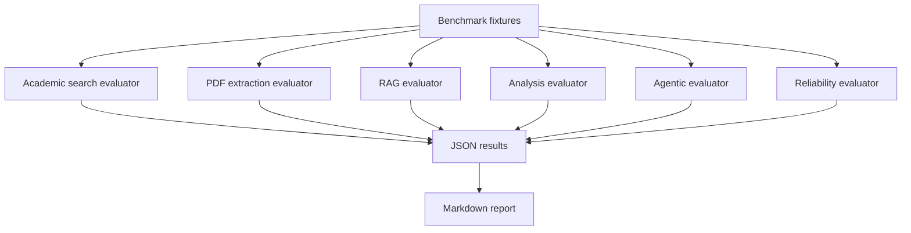

# AIRA Phase 9: Comprehensive System Evaluation and Reliability Report

**Report generated:** 2026-11-02 12:19:12 UTC
**Evaluation mode:** Offline deterministic and mocked evaluation. These results are not a substitute for live-provider or real-world validation.
**Language scope:** English and Amharic benchmark cases.
**RAG embedding provider:** MockEmbeddingProvider (synthetic embeddings; retrieval plumbing verification only)

## 1. Executive Summary

This report summarizes six evaluation components: academic search, PDF extraction, RAG retrieval, research analysis, agentic workflow checks, and reliability checks.

The benchmark suite primarily uses synthetic documents, mocked academic-provider responses, deterministic fixtures, and mock embeddings. It verifies selected software behaviors under controlled conditions. It does not establish general real-world research quality, live academic-search quality, or generated-answer factuality.

### Evaluation execution status

| Component | Execution status |
|---|---|
| Academic search | Completed |
| PDF extraction | Completed |
| RAG retrieval | Completed |
| Research analysis | Completed |
| Agentic workflow | Completed |
| Reliability | Completed |

**Failed evaluators:** None recorded

### Key measured results

| Area | Result | Interpretation |
|---|---:|---|
| Search P@5 | 0.6200 | Mock-candidate pipeline metric |
| Search R@5 | 1.0000 | Mock-candidate pipeline metric |
| Search MRR | 0.8667 | Mock-candidate pipeline metric |
| Search nDCG@5 | 0.8546 | Mock-candidate pipeline metric |
| Digital PDF field accuracy | 0.8889 | Synthetic digital PDFs only; 18 field checks |
| Scanned PDF handling score | 1.0000 | OCR-needed detection and graceful handling, not OCR text accuracy |
| RAG correct-paper rate | 100.0% | Mock-embedding retrieval plumbing |
| RAG correct-page rate | 50.0% | Page-level benchmark coverage |
| Analysis challenge cases | 5/5 | Component-level challenge checks |
| Agentic scenarios | 6/6 | Node/routing scenario checks, not end-to-end task success |
| Reliability checks | 4/4 | Four specific fault-handling checks |

---

## 2. Evaluation Architecture

The search evaluator injects mocked provider clients. The PDF evaluator creates synthetic PDFs. The RAG evaluator uses mock embeddings. The analysis and agentic evaluators exercise selected components and routes. The reliability evaluator injects selected provider and input failures.

## 3. Mathematical Metric Definitions and Formulas

For a cutoff K, Precision@K uses the fixed denominator K:

$$P@K = \frac{|Retrieved_{1:K} \cap Relevant|}{K}$$

Recall@K is the fraction of known relevant items retrieved:

$$R@K = \frac{|Retrieved_{1:K} \cap Relevant|}{|Relevant|}$$

MRR averages reciprocal rank of the first relevant result. nDCG uses graded relevance judgments and discounts lower-ranked results.

**Important:** A fixed-denominator P@K can be lower when fewer than K items are returned. This is intentional in the current metric implementation and must be interpreted alongside the actual returned-result count.

The RAG passage-support score is a lexical evidence-overlap proxy. It is not a measure of LLM-generated answer faithfulness. Page recall measures coverage of expected pages, not recall of all relevant chunks.

## 4. Benchmark Datasets Catalog

| Dataset | Size | Evaluation scope |
|---|---:|---|
| `academic_search_benchmark.json` | 10 queries | Graded relevance judgments; mocked candidate records |
| `pdf_extraction_benchmark.json` | 4 archetypes | Programmatically generated PDF fixtures |
| `rag_qa_benchmark.json` | 8 questions | Bilingual retrieval; scanned cases may be excluded |
| `analysis_comparison_benchmark.json` | 5 cases | Analysis and validation challenge fixtures |
| `agentic_scenarios_benchmark.json` | 6 scenarios | Selected LangGraph node and routing checks |
| `end_to_end_tasks.json` | 3 tasks | Benchmark definitions; not evidence of execution unless separately run |

## 5. Detailed Evaluation Results

### 5.1 Academic Search

- Queries: 10
- P@5: 0.6200; R@5: 1.0000
- P@10: 0.3100; R@10: 1.0000
- MRR: 0.8667
- nDCG@5: 0.8546; nDCG@10: 0.8546

The evaluator constructs candidate paper records from the benchmark relevance judgments and supplies them through mocked OpenAlex, Semantic Scholar, and Crossref clients. These metrics assess the controlled search/merge/ranking pipeline; they do not independently measure discovery quality on live academic indexes.

### 5.2 PDF Extraction

- Archetypes: 4
- Digital-document field checks: 18
- Digital-document field accuracy: 0.8889
- Page-count accuracy across archetypes: 100.0%
- OCR-required flag accuracy across archetypes: 100.0%
- Scanned-document handling score: 1.0000

All PDF fixtures are generated programmatically. The evaluator calls the automatic extraction path once per fixture; it does not perform an independent dual-engine comparison. The scanned fixture measures OCR-required detection and graceful handling only. OCR transcription accuracy is not evaluated, and the aggregate `mean_extraction_score` mixes different criteria across archetypes, so it is not presented as digital field accuracy.

### 5.3 RAG Retrieval

- Benchmark questions: 8
- Evaluated questions: 6
- Excluded questions: 2
- Embedding provider: MockEmbeddingProvider (synthetic embeddings; retrieval plumbing verification only)
- Correct-paper rate: 100.0%
- Correct-page rate: 50.0%
- Page precision@5: 0.1000
- Page recall: 0.5000
- Keyword recall proxy: 0.5000
- Ground-truth passage support proxy: 0.5000
- Unsupported passage proxy: 0.5000

The current RAG benchmark uses MockEmbeddingProvider. It validates indexing/retrieval plumbing with synthetic embeddings; semantic retrieval quality, especially cross-lingual Amharic retrieval, is not validated. Passage support is a lexical overlap proxy, not generated-answer faithfulness.

| Language | Evaluated questions | Correct-paper rate | Correct-page rate |
|---|---:|---:|---:|
| English | 4 | 100.0% | 50.0% |
| Amharic | 2 | 100.0% | 50.0% |

Excluded questions:
- `RAG_EN_05` (en): Scanned-document RAG is not evaluated: OCR is not implemented and the production indexer rejects SCANNED_NEEDS_OCR documents.
- `RAG_AM_03` (am): Scanned-document RAG is not evaluated: OCR is not implemented and the production indexer rejects SCANNED_NEEDS_OCR documents.

### 5.4 Research Analysis

- Challenge cases passed: 5/5
- Challenge-case pass rate: 100.0%

These are component-level challenge tests, not a broad evaluation of research-analysis quality. In particular, the insufficient-evidence case checks the benchmark input count rather than executing the complete agent response, and the contradictory-findings case has a permissive pass condition. The fabricated-citation case tests mocked registry responses. The unsupported-claim case uses a lexical grounding heuristic.

### 5.5 Agentic Workflow

- Scenarios passed: 6/6
- Scenario pass rate: 100.0%
- Stopping-condition scenario metric: 100.0%

The six scenarios test selected nodes and routing conditions. They do not constitute six complete end-to-end research tasks. The evaluator's retry rate and unnecessary-tool-call rate are not instrumented measurements and are intentionally omitted from the headline results. The degraded-mode scenario checks benchmark-declared deterministic tools rather than executing each listed tool.

### 5.6 Reliability

- Specific checks passed: 4/4
- Check pass rate: 100.0%

The checks cover a deterministic search/citation pipeline, partial academic-provider failure with Crossref fallback, corrupted-PDF handling, and blank-query validation. They do not establish general service availability or production reliability.

---

## 6. Error and Failure-Mode Analysis

1. **Live search quality is unmeasured:** the search benchmark supplies candidates derived from the relevance judgments.
2. **Scanned-PDF OCR is not implemented:** the evaluation verifies detection and graceful handling, not transcription.
3. **RAG semantic quality is unmeasured:** mock embeddings verify retrieval plumbing, not semantic or cross-lingual relevance.
4. **Grounding is approximate:** lexical overlap cannot reliably detect every unsupported scientific claim or semantic contradiction.
5. **Agentic evaluation is component-level:** node and routing checks do not demonstrate full-task completion, nor do they instrument all tool-use efficiency metrics.
6. **Small synthetic benchmarks limit generalization:** results should not be interpreted as statistically representative of real research papers or user requests.

## 7. System Limitations and Recommendations

1. Add a held-out search benchmark with independently collected live-provider results and human relevance judgments.
2. Evaluate extraction on a representative collection of real digital PDFs, and add OCR implementation plus character/word error rate evaluation for scanned documents.
3. Run RAG evaluation with the production embedding provider and report English and Amharic results separately.
4. Evaluate generated answers using claim-level evidence attribution and human review; retain lexical overlap only as a lightweight proxy.
5. Run complete end-to-end agent tasks and instrument actual tool calls, retries, plan changes, and stop reasons.
6. Expand fault injection to cover timeouts, provider outages, malformed tool outputs, vector-store failures, and recovery behavior.

The RAG implementation uses `gemini-embedding-2` in its production configuration, while this evaluation uses mock embeddings. The production embedding model has therefore not been benchmarked here.

## 8. Regression Testing Verification

The Phase 9 runner does not execute the full pytest suite or frontend build. Those checks must be run separately and their actual outputs recorded.

Previously reported project test result: **197 passed, 7 warnings**. This is a prior test run, not a result generated by this evaluation runner. Re-run the suite after applying changes.

No live LLM quota is required by the offline evaluator fixtures as currently designed. This statement does not imply that every project test or every application workflow is offline.
